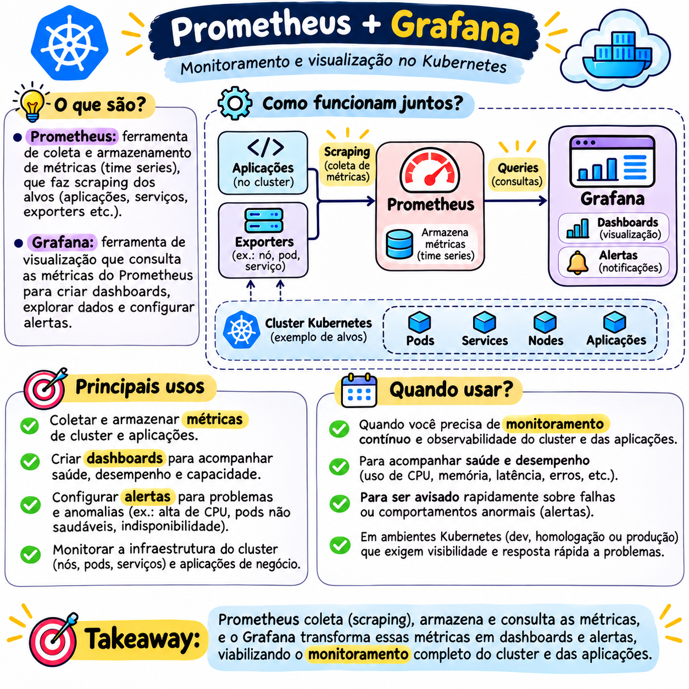

# 04.04 · Prometheus + Grafana

[⌂ Início](../../../README.md) · [↑ Camada 04](../README.md) · [📚 Catálogo](../../../docs/catalogo.md)

> **Ao concluir esta aula, você será capaz de:** Distinguir coleta de métricas, ServiceMonitor, PromQL e visualização no Grafana, com evidências de scrape funcional.

## 🎨 Infográfico



## 📖 Aula teórica

### Capacidade da ferramenta

Prometheus coleta séries temporais a partir de endpoints de métricas. Prometheus Operator permite configurar scraping por objetos como ServiceMonitor, selecionados por instâncias de Prometheus. Grafana consulta uma fonte de dados, cria dashboards e alertas; não é o coletor de métricas por si só.

### Como a reconciliação funciona

Um ServiceMonitor seleciona Services por labels e referencia o **nome da porta** em `endpoints.port`. A instância Prometheus precisa selecionar esse ServiceMonitor via selectors. Uma aplicação que não expõe formato Prometheus em `/metrics` não será monitorada corretamente só por existir um ServiceMonitor. O Grafana deve ter datasource configurado para consultar as séries.

### Exemplo interpretado (trecho)

```yaml
apiVersion: monitoring.coreos.com/v1
kind: ServiceMonitor
spec:
  selector:
    matchLabels:
      app: metrics-demo
  endpoints:
    - port: metrics
      path: /metrics
```

**Interpretação:** o trecho ilustra parte do contrato declarativo, não uma implantação pronta. A aula diferencia a sintaxe aceita pela API das consequências reais produzidas pelo controlador instalado.

### Inspeção no cluster

```bash
kubectl config current-context
kubectl api-resources --api-group=monitoring.coreos.com
kubectl get servicemonitor -n lab-04-04
kubectl get svc -n lab-04-04
```

**O que observar:** Valide o endpoint HTTP de métricas, o target `UP` no Prometheus e a consulta PromQL. Um ServiceMonitor aceito mas não selecionado não produz scrape.

### Limites e segurança

Requer Prometheus Operator/stack e integração de datasource Grafana. Sem addons, o Kind padrão valida apenas manifests básicos; a homologação funcional de scrape e dashboard é separada.

## 🧪 Aplicação prática

[🧪 Lab 04.04 — Prometheus + Grafana](../labs/prometheus-grafana-basico/README.md): escreva o recurso da ferramenta e execute verificações com pré-requisitos explícitos. **Labs que exigem CRDs, controladores ou AWS não são homologados no Kind padrão.**

**Complementar opcional:** [Aprofundamento e diagnóstico](complementares/README.md) para decisões e falhas comuns, sem substituir a aula e o lab.

## ✅ Revisão do aprendizado

- Por que ServiceMonitor criado não prova que Prometheus coletou métricas?
- Qual relação entre labels do Service e selector do ServiceMonitor?
- Por que Grafana não substitui o armazenamento de séries temporais?

## 🔗 Referências oficiais

- [Documentação oficial de Prometheus + Grafana](https://prometheus-operator.dev/docs/)

---

[← Aula 04.03](../cilium/README.md) · [↑ Camada 04](../README.md) · [🧪 Lab 04.04](../labs/prometheus-grafana-basico/README.md) · [↑ Catálogo de 49 aulas](../../../docs/catalogo.md)
